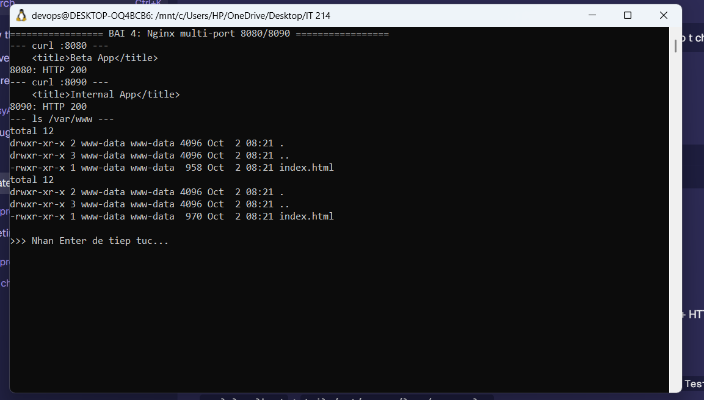
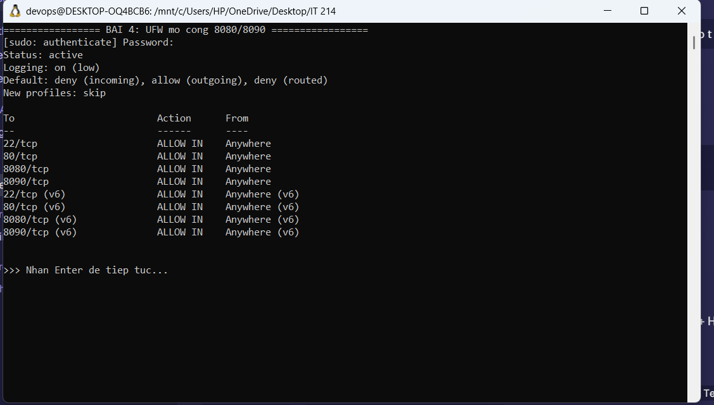

# Bài 4 (Session 03): Chạy song song nhiều cổng dịch vụ (Nginx Virtual Hosts)

## 1. Mục tiêu

- Cấu hình Nginx chạy **song song 2 trang web tĩnh độc lập** trên cùng một IP máy chủ bằng cách **phân chia theo cổng**: `8080` và `8090`.
- Mở cổng `8080`, `8090` trên **UFW** (OS) và **Cloud Firewall** (hạ tầng) để truy cập từ Internet.
- Ứng dụng: trang kiểm thử **Beta App** (8080) và trang thông tin nội bộ **Internal App** (8090).

## 2. Cấu trúc thư mục

```
Ex04/
├── README.md
├── setup.sh                              # Script tự động deploy toàn bộ
├── nginx/
│   └── multi-port.conf                   # 2 server block: 8080 + 8090
└── www/
    ├── beta-app/html/index.html          # -> /var/www/beta-app/html/
    └── internal-app/html/index.html      # -> /var/www/internal-app/html/
```

## 3. Ràng buộc

- Hai thư mục mã nguồn riêng: `/var/www/beta-app/html/` và `/var/www/internal-app/html/`, mỗi thư mục có `index.html` tiêu đề tương ứng.
- Server Block 1 lắng nghe **8080** → root `beta-app`.
- Server Block 2 lắng nghe **8090** → root `internal-app`.
- Mở `8080`, `8090` trên **UFW** và **Cloud Firewall**.

## 4. Thực hiện

### 4.1. Tạo hai thư mục web và file index

```bash
sudo mkdir -p /var/www/beta-app/html
sudo mkdir -p /var/www/internal-app/html
```

Nội dung `index.html` (xem file `www/*/html/index.html` trong repo).

### 4.2. Cấu hình Nginx

File `/etc/nginx/sites-available/multi-port.conf` (nội dung: `nginx/multi-port.conf`):

```nginx
server {
    listen 8080;
    listen [::]:8080;
    server_name _;
    root /var/www/beta-app/html;
    index index.html;
    location / { try_files $uri $uri/ =404; }
    access_log /var/log/nginx/beta-app.access.log;
    error_log  /var/log/nginx/beta-app.error.log;
}

server {
    listen 8090;
    listen [::]:8090;
    server_name _;
    root /var/www/internal-app/html;
    index index.html;
    location / { try_files $uri $uri/ =404; }
    access_log /var/log/nginx/internal-app.access.log;
    error_log  /var/log/nginx/internal-app.error.log;
}
```

Kích hoạt:

```bash
sudo ln -sf /etc/nginx/sites-available/multi-port.conf /etc/nginx/sites-enabled/multi-port.conf
sudo nginx -t
sudo systemctl restart nginx
```

### 4.3. Mở cổng tường lửa

**Lớp OS (UFW):**

```bash
sudo ufw allow 8080/tcp
sudo ufw allow 8090/tcp
sudo ufw reload
sudo ufw status verbose
```

**Lớp Cloud Firewall (DigitalOcean / Oracle VCN Security List):**

- Thêm Inbound Rule: TCP `8080` từ `0.0.0.0/0`.
- Thêm Inbound Rule: TCP `8090` từ `0.0.0.0/0`.

### 4.4. Chạy nhanh bằng script

```bash
chmod +x setup.sh
sudo ./setup.sh
```

## 5. Kiểm tra

```bash
curl http://<IP_ADDRESS>:8080
curl http://<IP_ADDRESS>:8090
```

Kết quả thực tế trên máy chủ (Ubuntu):

```
$ curl -s http://localhost:8080/ | grep -i '<title>'
    <title>Beta App</title>
$ curl -s http://localhost:8090/ | grep -i '<title>'
    <title>Internal App</title>

$ curl -s -o /dev/null -w '8080: HTTP %{http_code}\n' http://localhost:8080/
8080: HTTP 200
$ curl -s -o /dev/null -w '8090: HTTP %{http_code}\n' http://localhost:8090/
8090: HTTP 200
```

Trạng thái UFW (đã mở thêm 8080/8090):

```
$ sudo ufw status verbose
Status: active
To                         Action      From
--                         ------      ----
22/tcp                     ALLOW IN    Anywhere
80/tcp                     ALLOW IN    Anywhere
8080/tcp                   ALLOW IN    Anywhere
8090/tcp                   ALLOW IN    Anywhere
22/tcp (v6)                ALLOW IN    Anywhere (v6)
80/tcp (v6)                ALLOW IN    Anywhere (v6)
8080/tcp (v6)              ALLOW IN    Anywhere (v6)
8090/tcp (v6)              ALLOW IN    Anywhere (v6)
```

- Cổng **8080** trả về giao diện **Beta App**.
- Cổng **8090** trả về giao diện **Internal App**.

## 6. Ảnh chụp màn hình





## 7. Kết luận

- Nginx phục vụ 2 website tĩnh độc lập trên cùng 1 IP, phân tách theo cổng 8080/8090.
- UFW đã mở 8080/tcp và 8090/tcp; Cloud Firewall (DigitalOcean/Oracle) mở tương ứng.
- Truy cập từ ngoài Internet vào từng cổng trả về đúng trang tương ứng.
